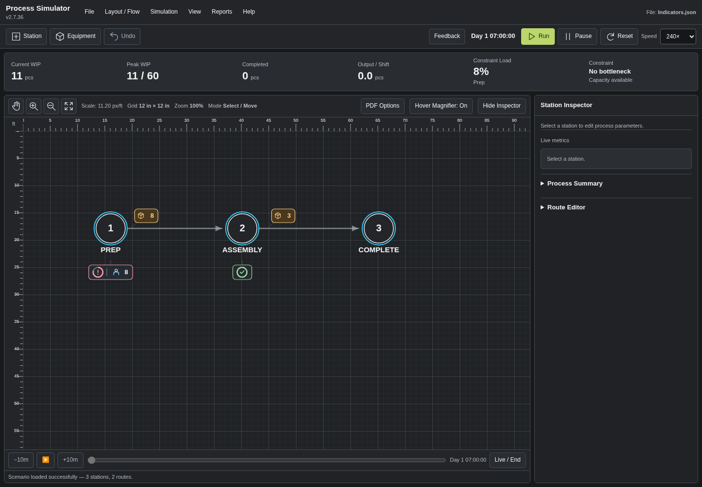
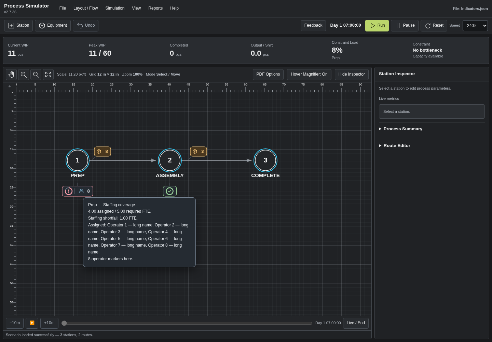

# Process Simulator

[Download the latest repaired simulator ZIP](https://github.com/jaredwolfepm-glitch/Process-Simulator/raw/refs/heads/main/Process_Simulator_Repaired.zip), extract it, and open **Process_Simulator_Repaired.html** in Chrome or Edge. The HTML contains its runtime assets, including PDF rendering.

## Compact headcount and WIP indicators

- Amber WIP badges keep the quantity visible.
- Coverage badges use a compact ring and check/shortfall symbol.
- Colocated operators group into one person icon with a count.
- Names, FTE details and explanatory labels appear **only on hover**.
- Spacing accounts for station labels and nearby equipment. Large dotted WIP halos and repeated per-person travel lines have been removed.

### Normal view

### Hover details

Staffing calculations and scenario fields are unchanged. Ten focused browser checks and six final workflow regressions passed; the source audit confirms 78 engine functions outside document reset remain unchanged. See [indicator design and test instructions](INDICATOR_REDESIGN.md).
